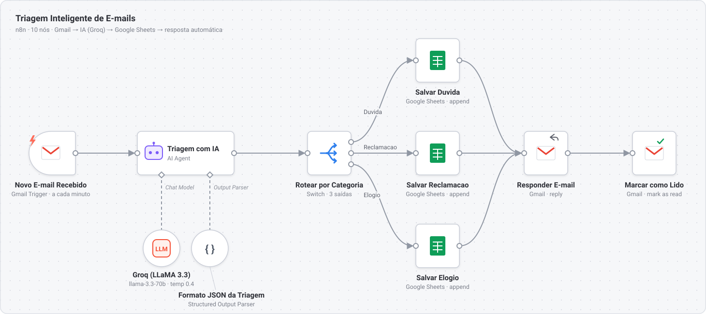
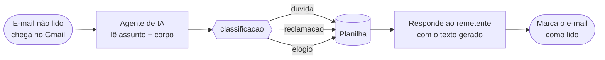

# Triagem inteligente de e-mails com n8n e IA

> **EN:** An n8n workflow that reads incoming Gmail messages, uses an LLM (LLaMA 3.3 70B on Groq) to
> classify each one as a question, complaint or compliment, logs it to Google Sheets and replies to the
> sender with a tone-appropriate answer. The model's output is forced into a JSON schema, so routing
> never depends on parsing free text.

Workflow de atendimento que lê os e-mails que chegam, **classifica cada mensagem com um LLM** (dúvida,
reclamação ou elogio), registra tudo em uma planilha e **responde ao remetente** no tom adequado à
categoria. Funciona sem nenhuma linha de código fora do n8n.

<div align="center">
  
</div>

## Como funciona



| # | Nó | Tipo | O que faz |
|---|---|---|---|
| 1 | Novo E-mail Recebido | Gmail Trigger | Verifica a caixa **a cada minuto** e só pega e-mails **não lidos** |
| 2 | Triagem com IA | AI Agent | Recebe assunto e corpo e devolve `classificacao` e `resposta` |
| 3 | Groq (LLaMA 3.3) | Chat Model | `llama-3.3-70b-versatile`, temperatura `0.4` |
| 4 | Formato JSON da Triagem | Structured Output Parser | Obriga a saída do modelo a seguir o JSON abaixo |
| 5 | Rotear por Categoria | Switch | Três saídas (`Duvida`, `Reclamacao`, `Elogio`), comparação sem diferenciar maiúsculas |
| 6–8 | Salvar Duvida / Reclamacao / Elogio | Google Sheets | Acrescenta uma linha com os dados do e-mail e a resposta gerada |
| 9 | Responder E-mail | Gmail | Responde **só ao remetente**, em texto puro, com a `resposta` da IA |
| 10 | Marcar como Lido | Gmail | Fecha o ciclo, para o e-mail não ser processado de novo |

## O contrato com o modelo

O agente recebe este prompt de sistema (resumido):

> Classifique a mensagem em exatamente uma destas três categorias: `"duvida"`, `"reclamacao"` ou
> `"elogio"` (minúsculas, sem acento). Gere uma resposta no tom da categoria: informativa para dúvida,
> empática e com solução para reclamação, calorosa e agradecida para elogio. Responda sempre no
> formato JSON definido.

E o *Structured Output Parser* garante que a saída tenha esta forma:

```json
{
  "classificacao": "reclamacao",
  "resposta": "Lamentamos muito pelo ocorrido e vamos resolver o quanto antes."
}
```

O Switch lê `$json.output.classificacao`. Como o formato é garantido pelo parser, o roteamento não
depende de interpretar texto livre do modelo.

## Planilha

Cada e-mail vira uma linha:

| Timestamp | Remetente | Assunto | Corpo | Classificacao | Resposta Gerada |
|---|---|---|---|---|---|
| `2026-05-20T23:41:07.512-03:00` | `cliente@exemplo.com` | Pedido atrasado | Comprei há 10 dias e… | `reclamacao` | Lamentamos muito pelo… |

*(linha ilustrativa)*

## Como rodar

1. Tenha um n8n rodando (n8n Cloud ou `docker run -it --rm -p 5678:5678 n8nio/n8n`).
2. Em **Workflows → Import from File**, importe [`workflow/triagem-inteligente-de-emails.json`](workflow/triagem-inteligente-de-emails.json).
3. Crie as três credenciais e selecione-as nos nós:
   - **Gmail OAuth2** (nós 1, 9 e 10);
   - **Groq API**, com uma chave gerada em console.groq.com (nó 3);
   - **Google Sheets OAuth2** (nós 6 a 8).
4. Crie uma planilha com as seis colunas acima e troque `SEU_ID_DA_PLANILHA` nos três nós de Sheets
   pelo ID dela.
5. Ative o workflow e mande um e-mail para a conta conectada.

## Decisões técnicas

- **Saída estruturada em vez de texto livre.** Sem o parser, o modelo pode responder
  "Classificação: Reclamação." e o Switch não casa com nada. Com o schema, o campo existe sempre.
- **Classificação e resposta numa chamada só.** Um único passo pelo LLM por e-mail, o que reduz custo e
  latência. A contrapartida é que não dá para trocar o modelo só da resposta.
- **Temperatura 0.4.** Baixa o bastante para a classificação ser estável e alta o bastante para a
  resposta não soar robótica.
- **Groq.** Serve o LLaMA 3.3 70B, um modelo aberto, com latência baixa e plano gratuito para testes.
  Como o modelo fica num nó separado, trocar de provedor é trocar só esse nó.
- **Marcar como lido só no fim.** Se algo falhar no meio, o e-mail continua não lido e fica visível
  para tratamento manual.

## Limitações e próximos passos

Registradas com honestidade, porque são o que eu mudaria antes de colocar isto em produção:

- **As três saídas gravam na mesma aba** (`Página1`). O Switch já separa os caminhos, mas hoje a
  separação só aparece na coluna `Classificacao`. O passo seguinte é uma aba por categoria.
- **Sem saída de fallback no Switch.** Se o modelo devolver algo fora das três categorias, o item para
  ali, sem registro nem resposta. O correto é uma quarta saída para revisão humana.
- **Resposta automática sem revisão.** Para reclamações, o ideal é a IA gerar um rascunho no Gmail e
  um humano aprovar o envio.
- **Dados pessoais na planilha.** Remetente e corpo do e-mail ficam gravados. Em uso real, isso pede
  controle de acesso à planilha e uma política de retenção (LGPD).
- **Polling a cada minuto.** Simples, mas consome execuções mesmo sem e-mail novo. Um webhook do Gmail
  (Pub/Sub) resolveria isso.

## Stack

n8n · AI Agent (LangChain) · Groq / LLaMA 3.3 70B · Gmail API · Google Sheets API
